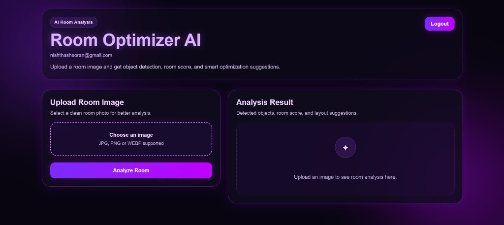
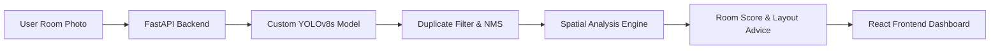

# 🚀 SpaceCraft — Room Optimizer AI

> **Transform room photos into actionable interior layout insights using Computer Vision and Spatial Heuristics.**



---

## 🌟 Overview

Arranging furniture is deceptively hard. Whether moving into a new apartment or redesigning a crowded bedroom, understanding spatial balance, walkway clearances, and focal points usually requires an interior designer.

**SpaceCraft (Room Optimizer AI)** brings intelligent spatial evaluation right to your browser. Simply snap and upload a picture of any room — the AI pipeline detects furniture, windows, and doors, calculates an intuitive **Room Score (0–100)**, and delivers clear, human-friendly recommendations to optimize room flow, eliminate clutter, and maximize living space.

---

## ✨ Key Features

- 🛋️ **Intelligent Object Detection**: Identifies beds, chairs, tables, sofas, doors, windows, storage units, nightstands, and lighting fixtures using a custom fine-tuned **YOLOv8** model.
- 📐 **Spatial Geometry & Proximity Engine**: Analyzes real physical relationships between objects (e.g., whether a nightstand is beside a bed, or if large furniture obstructs entryways).
- 🏆 **Dynamic Room Score (0–100)**: Evaluates clutter, walkway accessibility, functional grouping, and perimeter placement into a holistic layout score.
- 💡 **Actionable Optimization Advice**: Delivers personalized recommendations (e.g., repositioning center-heavy beds towards walls, opening door pathways).
- 🎨 **Modern Dark Neon UI**: Clean, responsive web interface built with React, Vite, and modern glassmorphism aesthetics.

---

## 🏗️ Architecture & Pipeline



1. **Image Preprocessing & Ingestion**: The uploaded image is received by FastAPI and normalized.
2. **YOLOv8 Detection**: Fine-tuned on interior furniture and architectural fixtures with custom confidence (`0.28`) and NMS thresholds (`0.45`).
3. **Bounding-Box Overlap Deduplication**: Eliminates multi-label ghost boxes and duplicate detections using custom IoU comparison.
4. **Heuristic Spatial Analysis**: Evaluates bounding box centers, relative proximity, wall clearances, and central room congestion.
5. **Score & Suggestion Generation**: Starts at a balanced baseline (`50`) and dynamically adjusts based on ergonomic and aesthetic guidelines.

---

## 🧠 Core Code Highlights

Here are the key algorithms powering SpaceCraft's detection and spatial intelligence:

### 1. Custom Bounding-Box Deduplication (`backend/detect.py`)
To prevent double-counting furniture (e.g., overlapping boxes on a large sofa or bed), SpaceCraft uses an IoU-based filtering pass:

```python
def calculate_iou(box1, box2):
    x1, y1, x2, y2 = box1
    a1, b1, a2, b2 = box2

    inter_x1 = max(x1, a1)
    inter_y1 = max(y1, b1)
    inter_x2 = min(x2, a2)
    inter_y2 = min(y2, b2)

    inter_w = max(0, inter_x2 - inter_x1)
    inter_h = max(0, inter_y2 - inter_y1)
    inter_area = inter_w * inter_h

    area1 = max(0, x2 - x1) * max(0, y2 - y1)
    area2 = max(0, a2 - a1) * max(0, b2 - b1)

    union = area1 + area2 - inter_area
    return inter_area / union if union > 0 else 0


def remove_duplicates(detections, iou_threshold=0.5):
    # Sort detections descending by confidence score
    detections = sorted(detections, key=lambda x: x["confidence"], reverse=True)
    filtered = []

    for det in detections:
        should_keep = True
        for kept in filtered:
            if det["label"] == kept["label"]:
                if calculate_iou(det["bbox"], kept["bbox"]) > iou_threshold:
                    should_keep = False
                    break
        if should_keep:
            filtered.append(det)

    return filtered
```

---

### 2. Spatial Geometry Engine (`backend/suggest.py`)
SpaceCraft determines whether furniture is clustered in the center, placed cleanly along walls, or obstructing movement paths:

```python
def get_center(bbox):
    x1, y1, x2, y2 = bbox
    return ((x1 + x2) / 2, (y1 + y2) / 2)

def is_near(obj1, obj2, threshold=180):
    c1 = get_center(obj1["bbox"])
    c2 = get_center(obj2["bbox"])
    distance = ((c1[0] - c2[0]) ** 2 + (c1[1] - c2[1]) ** 2) ** 0.5
    return distance < threshold

def is_in_center(obj, image_width=1000, image_height=1000):
    cx, cy = get_center(obj["bbox"])
    return (
        image_width * 0.3 <= cx <= image_width * 0.7
        and image_height * 0.3 <= cy <= image_height * 0.7
    )

def is_near_wall(obj, image_width=1000, image_height=1000, margin=120):
    x1, y1, x2, y2 = obj["bbox"]
    return (
        x1 < margin
        or y1 < margin
        or x2 > image_width - margin
        or y2 > image_height - margin
    )
```

---

### 3. Layout Scoring & Heuristic Feedback (`backend/suggest.py`)
Scores are computed dynamically based on interior design principles:

```python
def analyze_room(detections):
    suggestions = []
    score = 50  # Balanced starting baseline

    beds = [d for d in detections if d["label"] == "Bed"]
    storage_items = [d for d in detections if d["label"] in ["Shelf", "Cabinet", "Closet"]]
    doors = [d for d in detections if d["label"] == "Door"]

    # Encourage perimeter placement for large storage
    for item in storage_items:
        if is_near_wall(item):
            suggestions.append("Storage positioned against walls keeps central floor space open.")
            score += 6
            break

    # Flag blocked doorways
    for door in doors:
        for item in beds + storage_items:
            if is_near(door, item, threshold=140):
                suggestions.append("Clear pathways around doorways to maintain unobstructed entry.")
                score -= 8
                break

    # Penalize center-heavy layouts
    for bed in beds:
        if is_in_center(bed):
            suggestions.append("The bed appears close to the room center. Shifting it towards a wall improves flow.")
            score -= 6

    # Clamp final score between 0 and 100
    return {"score": max(0, min(100, score)), "suggestions": suggestions}
```

---

### 4. RESTful API Pipeline (`backend/app.py`)
```python
@app.post("/analyze-room")
async def analyze_room_api(request: Request, file: UploadFile = File(...)):
    safe_name = file.filename.replace(" ", "_")
    file_path = os.path.join(UPLOAD_DIR, safe_name)

    with open(file_path, "wb") as buffer:
        shutil.copyfileobj(file.file, buffer)

    # Run AI inference and spatial scoring
    detections = detect_room_objects(file_path)
    analysis = analyze_room(detections)

    return JSONResponse({
        "filename": safe_name,
        "detections": detections,
        "room_score": analysis["score"],
        "suggestions": analysis["suggestions"],
        "image_output_url": f"{request.base_url}outputs/room_test/{safe_name}",
    })
```

---

## 🛠️ Tech Stack

| Domain | Technologies |
|---|---|
| **AI / Computer Vision** | Ultralytics YOLOv8s, PyTorch, OpenCV, NumPy |
| **Backend API** | FastAPI, Uvicorn, Python 3.10+ |
| **Frontend UI** | React 18, Vite, Tailwind CSS, Lucide Icons |
| **Authentication** | Firebase Auth |

---

## ⚡ Quick Start Guide

### Prerequisites
- Python 3.10+
- Node.js 18+ and npm
- Git

### 1. Clone Repository
```bash
git clone https://github.com/Nishtha-1111/SpaceCraft.git
cd SpaceCraft
```

### 2. Backend Setup
```powershell
# Activate virtual environment
venv\Scripts\activate

# Navigate and install dependencies
cd backend
pip install -r requirements.txt

# Start backend server
uvicorn app:app --reload
```
*API runs at `http://127.0.0.1:8000` (docs available at `/docs`)*

### 3. Frontend Setup
```powershell
# Open a new terminal
cd frontend

# Install packages
npm install

# Start Vite dev server
npm run dev
```
*Web dashboard opens at `http://localhost:5173`*

---

## 📂 Project Structure

```text
SpaceCraft/
├── assets/                  # Project screenshots & visual assets
│   └── dashboard-preview.jpg
├── backend/                 # FastAPI REST application
│   ├── model/               # Trained model weights (best.pt)
│   ├── app.py               # API endpoints & routing
│   ├── detect.py            # YOLOv8 inference & IoU deduplication
│   ├── suggest.py           # Spatial geometry & scoring heuristics
│   └── requirements.txt
├── frontend/                # React (Vite) client
│   ├── src/                 # Components, hooks & views
│   └── package.json
├── training/                # YOLOv8 custom training scripts
│   └── train.py
├── data/                    # Dataset configs & raw labels
├── PROJECT_SUMMARY.md       # Comprehensive architecture docs
└── README.md                # Humanized project overview
```

---

## 🤝 Contributing
Contributions, bug reports, and layout suggestions are always welcome! Feel free to open an issue or submit a pull request.

---

## 📄 License
This project is open-source and available under the [MIT License](LICENSE).
